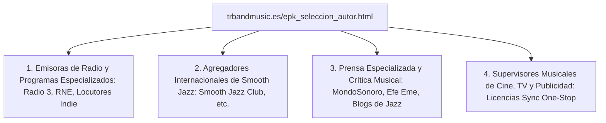

# 📣 Plan de Difusión & Airplay: trbandmusic.es

El objetivo central de este plan es la **propuesta directa de emisión (Airplay) y cobertura en medios** del catálogo de **The Research Band**, dirigiéndonos a directores musicales, locutores y programadores mediante una presentación ágil, profesional y con respaldo 100% One-Stop SGAE.

---

## 🎯 Canales Objetivo



---

## 📻 1. Plantilla Oficial: Radios y Programas Especializados (España)

* **Asunto sugerido:** `Propuesta de emisión (Airplay) • The Research Band: «Medianoche en la terraza» / «Dreams and other things»`

```text
Estimado/a [Nombre / Director/a Musical]:

Soy Eduardo Ramírez de Cartagena, compositor y productor de 'The Research Band' (Madrid).

Me dirijo a usted para someter a consideración de emisión en su programa / emisora nuestros temas «Medianoche en la terraza» y «Dreams and other things» [o «Wild and Free»], dentro de una propuesta que fusiona el Smooth Jazz elegante, Jazz-Rock contemporáneo y Art Rock con producción analógica y digital de alto nivel.

Todos los derechos de máster y editorial están 100% bajo mi control (One-Stop) y registrados en la SGAE (Socio Nº 29.751).

🎧 Dossier Oficial y Escucha de Temas (EPK):
https://trbandmusic.es/epk_seleccion_autor.html

Disponemos de inmediato de los archivos masterizados de emisión en WAV Broadcast a 44.1 kHz / 24 bits y MP3s a 320 kbps con metadatos ID3 completos. Si le apetece programar alguno de ellos o comentar cualquier detalle, se los enviamos al momento en respuesta a este correo.

Muchas gracias por su atención y apoyo a la música de autor.

Atentamente,

Eduardo Ramírez de Cartagena
The Research Band • Khem Aura Records
trbandmusic.es | eduardo@trbandmusic.es | +34 611 818 352
```

---

## 🌍 2. Plantilla Internacional: Smooth Jazz & Global Radios (Inglés)

* **Subject:** `Airplay Submission • The Research Band: "Medianoche en la terraza" & "Wild and Free"`

```text
Dear Music Director,

I am Eduardo Ramírez de Cartagena, composer and producer of 'The Research Band' (Spain).

I would like to submit our tracks "Medianoche en la terraza" and "Wild and Free" (along with "All Around If You Want") for airplay consideration on your station and featured playlists. We specialize in elegant Smooth Jazz, Chillout, and Contemporary Fusion.

All master and publishing rights are 100% One-Stop controlled by me and registered in SGAE (Member No. 29.751).

🎧 Official EPK & Audio Sampler:
https://trbandmusic.es/epk_seleccion_autor.html

Our 44.1kHz Broadcast WAV files and ID3-tagged 320kbps MP3s are available immediately upon request at eduardo@trbandmusic.es.

Thank you very much for your time and consideration.

Best regards,

Eduardo Ramírez de Cartagena
The Research Band • Khem Aura Records
trbandmusic.es | eduardo@trbandmusic.es
```

---

## 📰 3. Plantilla: Prensa Musical, Reseñas y Blogs de Vanguardia

* **Asunto sugerido:** `The Research Band: nueva propuesta de Jazz-Rock y Smooth Jazz de autor`

```text
Hola [Nombre],

Te contacto para presentarte el nuevo material discográfico de 'The Research Band', proyecto instrumental y vocal concebido y producido por Eduardo Ramírez de Cartagena.

Tras una dilatada trayectoria en la composición y producción de sonido en España, este catálogo sintetiza la elegancia del Smooth Jazz contemporáneo con el dinamismo del Jazz-Rock y la experimentación acústico-electrónica, contando con destacados músicos de sesión y solistas invitados.

Acabamos de habilitar el dossier electrónico de prensa (EPK) donde puedes escuchar una cuidada selección de 7 temas representativos:

👉 Dossier de Prensa y Sampler:
https://trbandmusic.es/epk_seleccion_autor.html

Si te interesa recibir el álbum completo para reseña, entrevistas o cobertura en tu medio, quedo a tu entera disposición.

Un cordial saludo,

Eduardo Ramírez de Cartagena
The Research Band
trbandmusic.es | eduardo@trbandmusic.es | +34 611 818 352
```

---

## 📁 Archivos y Enlaces Relacionados
* [Ver Agenda de Contactos de Medios](LISTADO_CONTACTOS_PROMO_MUSIC.html)
* [Ver Dossier EPK en Directo](https://trbandmusic.es/epk_seleccion_autor.html)
